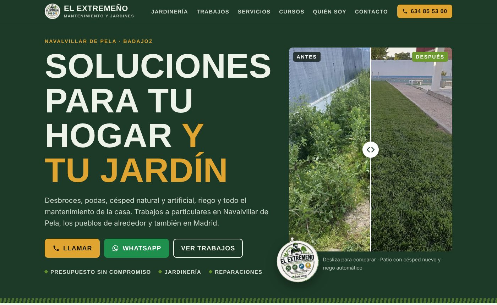
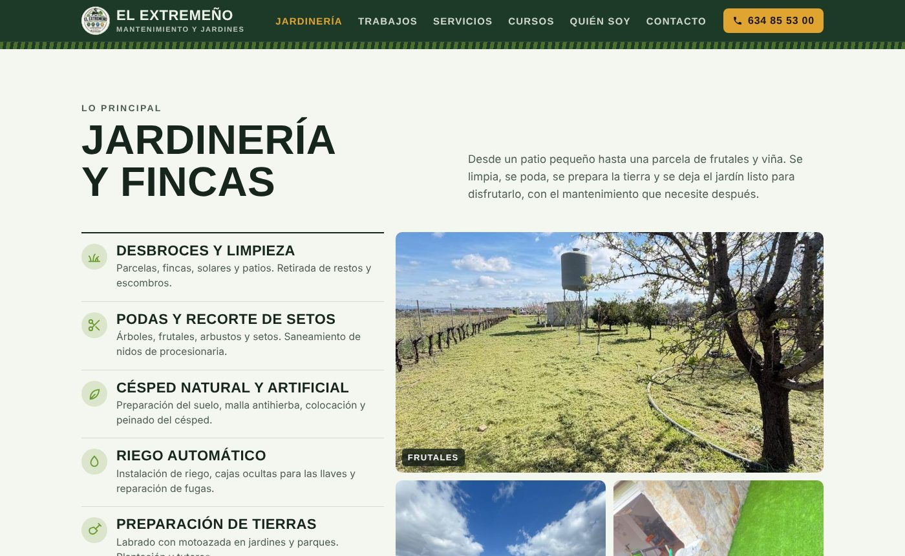
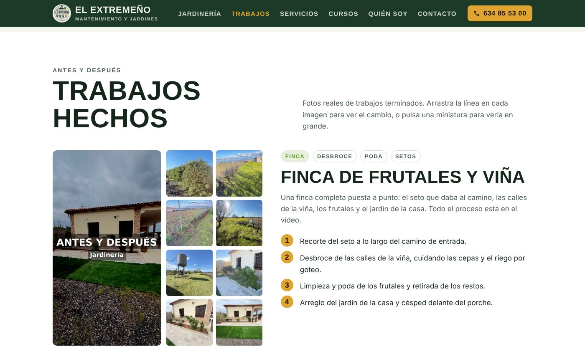
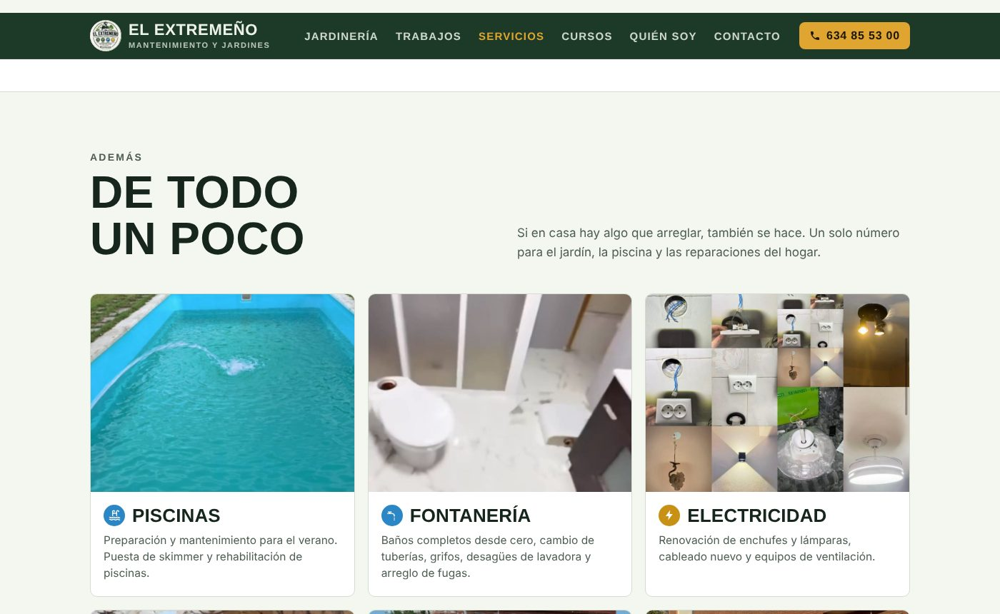
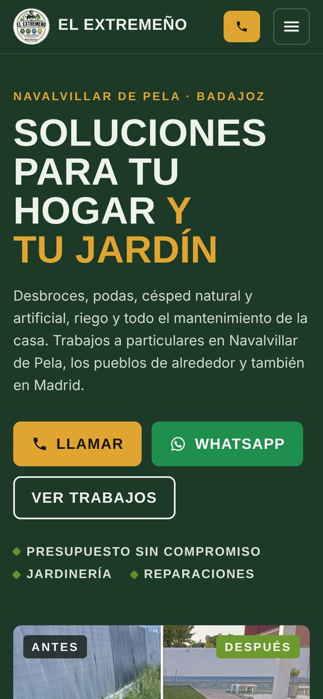

<div align="center">
  
</div>

<div align="center">
  <a href="https://github.com/evagr11/el-extremeno" target="_blank"></a>
  <a href="https://el-extremeno.evagallardor.workers.dev/" target="_blank"></a>
</div>

<div align="center">
  <a href="https://git.io/typing-svg"></a>
</div>

# 🚀 Sobre el Proyecto

**El Extremeño · Mantenimiento y Jardines** es la web de presentación del negocio de **Alfonso Martín Blanco**, que hace jardinería, desbroces, podas, riego y todo tipo de reparaciones del hogar en **Navalvillar de Pela (Badajoz)**, los pueblos de alrededor y Madrid.

El objetivo era sencillo: que quien llegue desde Instagram o una búsqueda vea **trabajos reales** y pueda **llamar o escribir por WhatsApp** en un toque. Por eso la web gira alrededor de las fotos de antes y después y de los botones de contacto, siempre visibles.

<div align="center">
  
  <p><em>Portada con el comparador antes/después y los botones de contacto</em></p>
</div>

✨ **Características principales:**

*   ↔️ **Comparador antes/después:** Se arrastra la línea sobre la foto para ver el cambio. Funciona con ratón, dedo y teclado, porque por debajo es un `input type="range"`.
*   🖼️ **Galería con visor:** Las miniaturas de cada trabajo se abren en grande en un visor hecho con `<dialog>`, que se cierra con la X, con Escape o pulsando fuera.
*   🎬 **Vídeo del proceso:** Reel de la finca que solo se descarga cuando se le da al play (`preload="none"`), para no gastar datos de quien no lo vea.
*   📞 **Contacto directo:** Botones de llamar y WhatsApp, teléfono fijo en la cabecera y botón para **copiar el número**.
*   📱 **Mobile-first:** Pensada primero para el móvil, que es desde donde llega la mayoría de la gente, con menú desplegable accesible (`aria-expanded`).
*   🌙 **Modo oscuro automático:** Se adapta al tema del dispositivo con `prefers-color-scheme`.
*   🔎 **SEO local:** Datos estructurados `LocalBusiness` (JSON-LD), etiquetas Open Graph con imagen para compartir por WhatsApp y redes, y `canonical`.
*   ⚡ **Ligera:** Sin frameworks ni librerías, imágenes con `loading="lazy"` y caché de 30 días para imágenes y vídeo en Cloudflare.
*   🔒 **Privacidad:** En las fotos del curso, las caras de las alumnas aparecen difuminadas.

### Galería de Secciones

| Jardinería y fincas | Trabajos hechos |
| :-----------------: | :-------------: |
|  |  |
| *Lo principal del negocio, con sus servicios.* | *Cada trabajo con su galería y los pasos que se hicieron.* |
| **De todo un poco** | **Versión móvil** |
|  |  |
| *Piscinas, fontanería, electricidad, albañilería…* | *Botón de llamada y menú siempre a mano.* |

# 🧠 Contexto del Proyecto

Es un **proyecto real** para un negocio local de mi zona. Alfonso trabajaba solo con Instagram ([@mantenimientos_y_jardines_](https://www.instagram.com/mantenimientos_y_jardines_/)) y necesitaba una web a la que mandar a los clientes, con sus trabajos ordenados y una forma rápida de contactar.

Me encargué de todo el proceso: organizar el contenido con él (la jardinería como sección principal y el resto de servicios aparte), seleccionar y optimizar las fotos, diseñar y programar la web y publicarla en **Cloudflare Pages** conectada a este repositorio, de forma que cada cambio se publica solo.

<div align="center">

| Sección | Contenido |
| :------ | :-------- |
| **Jardinería y fincas** | Desbroces, podas y setos, césped natural y artificial, riego automático, preparación de tierras, injertos y fitosanitarios |
| **Trabajos hechos** | Antes y después de una finca de frutales y viña, patios con césped, un chalet con pinos (poda y procesionaria), con galería y vídeo |
| **De todo un poco** | Piscinas, fontanería, electricidad, albañilería, pintura y cerrajería, mallas y brezos |
| **Curso** | *Habilidades para el día a día*, impartido para el Ayuntamiento de Navalvillar de Pela |
| **Quién soy** | Presentación de Alfonso y zona de trabajo |
| **Contacto** | Teléfono, WhatsApp e Instagram |

</div>

# 🛠️ Stack Tecnológico

<div align="center">
  
  
  
  
  
</div>

<br>

<div align="center">

| Área | Tecnología |
| :--- | :--------- |
| **Frontend** | `HTML5` semántico, `CSS3` (variables, Grid, Flexbox), `JavaScript` (Vanilla) |
| **Tipografía** | `Barlow` y `Barlow Condensed` (Google Fonts) |
| **SEO** | JSON-LD `LocalBusiness`, Open Graph, `robots.txt` |
| **Despliegue** | `Cloudflare Pages` con publicación automática desde GitHub |
| **Caché** | Archivo `_headers` de Cloudflare |

</div>

# 📂 Estructura del Proyecto

```bash
el-extremeno/
├── index.html        # Estructura de la página
├── css/
│   └── styles.css    # Variables de color y fuentes al principio, luego cada sección
├── js/
│   └── main.js       # Menú móvil, comparador, visor de fotos, vídeo y copiar teléfono
├── img/              # Fotos, logo, favicon e imagen para compartir (og.jpg)
├── video/
│   └── reel.mp4      # Vídeo de la finca
├── .github/readme/   # Capturas de este README
├── _headers          # Caché de imágenes y vídeo en Cloudflare Pages
├── robots.txt
└── README.md
```

# 🚀 Cómo Utilizar el Proyecto

### 1. Verla online

**[el-extremeno.evagallardor.workers.dev](https://el-extremeno.evagallardor.workers.dev/)**

### 2. Probarla en local

1.  Clona el repositorio:
    ```bash
    git clone https://github.com/evagr11/el-extremeno.git
    ```
2.  Navega a la carpeta del proyecto:
    ```bash
    cd el-extremeno
    ```
3.  Levanta un servidor local y entra en `http://localhost:8000`:
    ```bash
    python -m http.server
    ```
    También se puede abrir `index.html` directamente, pero con servidor se comporta igual que publicada.

### 3. Publicar cambios

La web está conectada a **Cloudflare Pages**: cada `git push` a `main` la vuelve a publicar automáticamente en un par de minutos. No hay paso de compilación (*Framework preset: None*, *Build output directory: `/`*).

### 4. Mantenimiento

- **Colores:** se cambian todos desde las variables de `:root` al principio de `css/styles.css`. El modo oscuro tiene las suyas justo debajo.
- **Fotos nuevas:** se añaden en `img/` y se enlazan en `index.html`, con `loading="lazy"` y un `alt` que describa la foto.
- **Dominio propio:** si se compra uno (por ejemplo `elextremeno.es`), se añade en Cloudflare en *Custom domains* y hay que cambiar la dirección actual en `index.html`: etiquetas `canonical`, `og:url`, `og:image` y el bloque `application/ld+json`.

### 📌 Pendiente

- [ ] Logo en buena calidad: sustituir `img/logo.png` y regenerar `favicon-32.png` y `apple-touch-icon.png`.

<br>

<div align="center">
  <p>Creado por <strong>Eva Gallardo</strong></p>
  <a href="https://github.com/evagr11" target="_blank">
    
  </a>
  <a href="https://www.linkedin.com/in/eva-gallardo-romero-830362349/" target="_blank">
    
  </a>
</div>

<div align="center">
  
</div>
